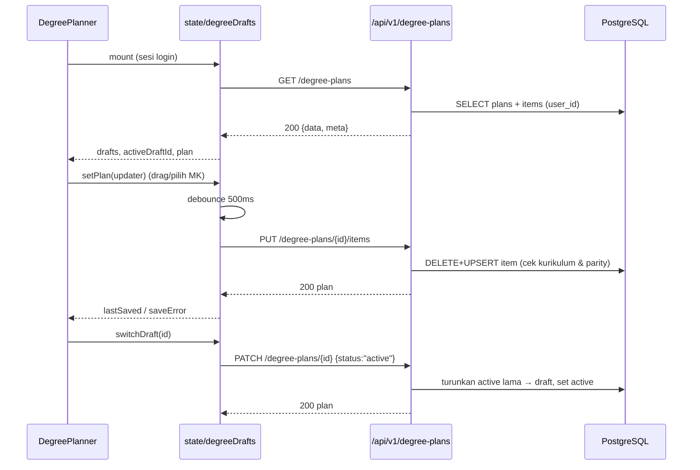
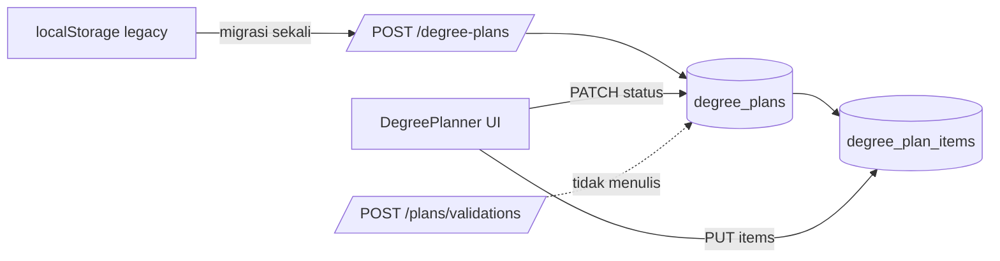

# Low-Level Plan: Persistensi Rencana Studi (Degree Plan) ke Backend

**Document ID:** `PLAN-DEGREE-PLAN-DB-20261108`
**Branch:** `refactor/untangle-audit` (lanjutkan di branch ini; dilarang `main`)
**Basis commit:** `8d4d6c4`
**Status:** Selesai dieksekusi — inti 2026-11-08 (§12), Fase 2 item #1–#3 2026-11-14 (§13). Sisa: §9.4 (kolaborasi dosen/PA) tetap backlog.

---

## 1. Masalah & Akar

| Gejala terukur | Bukti |
|---|---|
| Degree Planner kehilangan seluruh isi saat `localStorage` dibersihkan / ganti perangkat | `src/components/degree-planner/useDegreePlanStorage.ts:4` (`ftmm_compass_degree_drafts_v2`) |
| "Direncanakan 6 MK / 17 SKS" di Dashboard tidak pernah cocok dengan Degree Planner | Dashboard membaca `student_course_records.record_status='taking'` (`backend/api/dashboard.py:125-138`); planner membaca `localStorage` |
| Tabel `degree_plans` + `degree_plan_items` sudah ada, trigger-nya menegakkan aturan, tetapi nol baris | DDL `database/schema_v2_1_rc1.sql:571-607`, trigger `:1515-1594`; isi DB: `degree_plans=0`, `degree_plan_items=0` |
| Tidak ada ORM map untuk kedua tabel | `backend/models.py` berakhir di `ChatLog` (baris 509-534); grep `degree_plan` = 0 hit |
| Penyimpanan draft menyembunyikan kegagalan | `useDegreePlanStorage.ts:95` (`catch {}` pada quota/private mode), `:83` (`catch {}` pada JSON rusak) |
| "Lulus (Terkunci)" di legenda planner adalah status yang tidak pernah diproduksi kode mana pun | `grep '"completed"' src` → hanya pembaca; penulis selalu `"planned"` (`src/pages/DegreePlanner.tsx:109,139`) |
| Draft memilih MK lintas prodi, sedangkan trigger item menolak MK di luar kurikulum mahasiswa | `src/pages/DegreePlanner.tsx:65` (`pickerProgram` default `"all"`) vs `validate_degree_plan_item()` (`schema:1557-1594`) |

**Akar:** pemilik state rencana studi ada di browser, sementara database sudah menyediakan tempatnya. Selama pemiliknya browser, data tidak bisa bertahan, tidak bisa direkonsiliasi, dan kegagalan simpan tidak terlihat.

---

## 2. Keputusan Desain

Format: keputusan → alasan → masalah yang dihapus.

### D1. Pemilik tunggal rencana = database, bukan `localStorage`

- Alasan: `degree_plans` sudah memuat semantik yang tepat (`plan_name`, `status`, `target_graduation_semester`, item per semester) dan trigger-nya sudah menegakkan integritas.
- Menghapus: draft hilang saat ganti browser; dua definisi "rencana" (browser vs DB).

### D2. Tidak ada migrasi skema baru

- Alasan: DDL, index (`idx_degree_plan_items_plan_semester`), trigger `touch_updated_at`, dan constraint sudah lengkap di baseline V2.1 RC1. Yang kurang hanya model SQLAlchemy + endpoint.
- Konsekuensi: `alembic upgrade head` tidak berubah; CI tetap hijau tanpa revisi baru.
- Temuan saat eksekusi: `StudentCurriculumAssignment` ORM belum memetakan kolom `effective_from`, `effective_until`, `assignment_source`, `change_reason`. Tanpa itu, menonaktifkan assignment lama melanggar `student_curriculum_assignments_current_end_check` (`is_current=false` wajib `effective_until` terisi). Perbaikan = menambah 4 kolom ke model (tanpa DDL).
- Menghapus: kebutuhan menulis migrasi, menambah risiko rollback.

### D3. Bentuk resource mengikuti tabel: `degree-plans` (plural, kebab-case) + sub-resource `items`

- Alasan: satu resource = satu tabel. Nama `plans` sudah dipakai untuk sintesis AI (`POST /api/v1/plans`), jadi `degree-plans` tidak bertabrakan dan menunjukkan bedanya: rencana tersimpan vs hasil generasi.
- Menghapus: endpoint generik dengan mode campuran.

### D4. Nama draft = `degree_plans.plan_name`; aktif = `status='active'`

- Alasan: `UNIQUE (student_curriculum_assignment_id, plan_name)` dan partial unique index `degree_plans_one_active_per_user` sudah menjadi penjaga. Server tinggal memetakan konflik → `409`.
- Field `description` pada draft dihapus: tidak pernah diisi UI (`DegreePlanner.tsx:400` hanya mengirim nama) dan tidak punya kolom. Header memakai teks status simpan.
- Menghapus: field mati di tipe frontend, kolom baru yang tidak dipakai.

### D5. Persistensi TIDAK menjalankan validasi akademik

- Alasan: aturan parity & prasyarat sudah punya satu tempat (`backend/tools/prerequisite_validator.py` via `POST /api/v1/plans/validations`, dan `src/domain/*`). Menyimpannya berkali-kali di jalur simpan = salinan aturan ketiga.
- Batas yang tetap ditegakkan saat simpan hanya integritas referensial + constraint DB: MK harus milik kurikulum mahasiswa, semester 1-14, parity sesuai `term` MK (trigger `validate_degree_plan_item`), maks 10 draft.
- UI sudah mencegah parity salah (`canDrop`, `src/components/degree-planner/types.ts:15-28`; picker memfilter parity semester), jadi 422 parity hanya jalur pertahanan terakhir.
- Menghapus: duplikasi aturan, dan autosave yang "kadang menolak" tanpa penjelasan.

### D6. Picker dibatasi ke kurikulum mahasiswa

- Alasan: trigger menolak item di luar kurikulum; membiarkan pilihan lintas prodi hanya menghasilkan 422 yang tidak bisa diperbaiki dari UI.
- Perubahan: `pickerProgram` dihapus sebagai state UI dan diganti prop `currentProgram` (nilai `user.student_profile.study_program` dari `useSession()`; `useCatalog()` memuat `"all"` — lihat `src/state/catalog.tsx:35` — jadi filter wajib dilakukan di picker). Selector prodi dihapus dari `CoursePickerModal`.
- Menghapus: kontrol yang menyediakan pilihan mustahil.

### D7. "Reset" = muat ulang dari server

- Alasan: `initialPlan` saat ini adalah snapshot acak (kapan aplikasi dibuka), hanya ada di localStorage, dan menambah cabang khusus di storage.
- Perubahan: `resetCurrentDraft()` → `GET` ulang plan aktif. `initialPlan` dihapus dari tipe.
- Menghapus: field turunan yang tidak bisa disimpan, satu kelas bug "reset memulihkan versi yang salah".

### D8. `status: "completed"` tidak disimpan; sumbernya nanti `student_course_records`

- Alasan: item rencana hanya `planned|wishlist` (constraint DB). Riwayat lulus sudah punya tabel sendiri; menyalinnya ke item membuat dua sumber untuk "sudah lulus".
- Scope plan ini: tetap `planned`. Deriving "Lulus" dari `student_course_records` = Fase 2 (§9), memakai resource terpisah, bukan dicampur ke payload draft.

### D9. Kurikulum mahasiswa adalah batas sah rencana, dan picker membaca katalog kurikulum itu

- Temuan saat eksekusi: mahasiswa seed punya assignment ke `Kurikulum TSD 2023` (31 MK), sedangkan `/api/v1/courses` melayani kurikulum terbesar per prodi (101 MK). Tanpa penyesuaian, hampir semua MK di picker ditolak trigger `curriculum_mismatch`.
- Percobaan pertama (dibatalkan): membuat assignment baru ke kurikulum terbesar lalu menonaktifkan assignment lama. Ini merusak fitur lain — trigger timetable mewajibkan timetable aktif memakai assignment `is_current`, sehingga membuka Degree Planner mematikan jadwal seed. Rollback.
- Keputusan final: assignment mahasiswa tidak diubah. Sebagai gantinya `GET /api/v1/degree-plans/catalog` mengembalikan MK milik kurikulum assignment pengguna, dan picker memakai daftar itu (bukan katalog global 411 MK yang tetap dipakai Course Finder untuk eksplorasi).
- Menghapus: kontrol picker yang menawarkan MK yang mustahil disimpan, tanpa memutasi data akademik.

### D10. Autosave: debounce 500ms + flush eksplisit, kegagalan terlihat

- Alasan: pola debounce yang sudah ada dipertahankan (UX sama), tetapi `catch {}` diganti state `saveError` + tombol "Coba lagi". Flush dijalankan sebelum pindah draft, aktivasi, hapus, logout, dan `beforeunload`.
- Menghapus: swallowed exception, kehilangan data senyap.

---

## 3. Skema Data (sudah ada — tanpa migrasi)

```text
student_curriculum_assignments (1) ──< degree_plans (N)
                                        │  degree_plan_id uuid PK
                                        │  user_id uuid NOT NULL
                                        │  student_curriculum_assignment_id uuid NOT NULL
                                        │  plan_name varchar(100) NOT NULL DEFAULT 'Rencana Utama'
                                        │  status varchar(30) ('draft'|'active'|'archived')
                                        │  target_graduation_semester smallint NULL (7..14)
                                        │  created_at, updated_at timestamptz
                                        └─< degree_plan_items (N)
                                              degree_plan_item_id uuid PK
                                              curriculum_course_id uuid NOT NULL
                                              planned_semester smallint (1..14)
                                              planning_status varchar(20) ('planned'|'wishlist')
                                              notes text NULL
```

Constraint & trigger yang mengikat implementasi:

| Objek | Aturan | Perilaku endpoint |
|---|---|---|
| `degree_plans_one_active_per_user` | maksimal 1 plan `active` per user | `PATCH status=active` menurunkan plan aktif lama ke `draft` dalam transaksi yang sama |
| `degree_plans_assignment_name_unique` | nama unik per assignment | konflik → `409 duplicate_plan_name` |
| `validate_degree_plan()` | plan harus milik user pemilik assignment; `active` wajib assignment `is_current`; target ≥ semester sekarang | assignment tidak current saat aktivasi → `409 assignment_not_current` |
| `validate_degree_plan_item()` | MK wajib dari kurikulum plan; parity `planned_semester` vs `curriculum_courses.term` | pre-check di service → `422 curriculum_mismatch` / `422 parity_mismatch` |
| `ON DELETE RESTRICT` (item) | plan tidak bisa dihapus bila masih punya item | service menghapus item lalu plan dalam satu transaksi |
| `trg_degree_plans_touch_updated_at` | `updated_at` otomatis | jangan set `updated_at` manual |

Field DB yang tidak dipakai klien: `target_graduation_semester`, `start_academic_year`, `notes`, `planning_status='wishlist'` (disimpan NULL/default, tidak diekspos di UI).

---

## 4. Perubahan Backend (per file)

### 4.1 `backend/models.py` — baris 534 (append setelah `ChatLog`)

Tambah dua model ORM, relasi `User.degree_plans` dan `DegreePlan.items`:

```python
class DegreePlan(Base):
    __tablename__ = "degree_plans"
    degree_plan_id: Mapped[uuid.UUID] = mapped_column(UUID(as_uuid=True), primary_key=True, default=uuid.uuid4)
    user_id: Mapped[uuid.UUID] = mapped_column(UUID(as_uuid=True), ForeignKey("users.user_id", ondelete="RESTRICT"), nullable=False)
    student_curriculum_assignment_id: Mapped[uuid.UUID] = mapped_column(
        UUID(as_uuid=True),
        ForeignKey("student_curriculum_assignments.student_curriculum_assignment_id", ondelete="RESTRICT"),
        nullable=False,
    )
    plan_name: Mapped[str] = mapped_column(String(100), nullable=False, default="Rencana Utama")
    status: Mapped[str] = mapped_column(String(30), nullable=False, default="draft")
    target_graduation_semester: Mapped[Optional[int]] = mapped_column(SmallInteger, nullable=True)
    created_at / updated_at: DateTime(timezone=True), server_default=func.now()
    assignment: relationship("StudentCurriculumAssignment")
    items: relationship("DegreePlanItem", back_populates="plan", cascade="all, delete-orphan")
```

```python
class DegreePlanItem(Base):
    __tablename__ = "degree_plan_items"
    degree_plan_item_id / degree_plan_id / curriculum_course_id / planned_semester / planning_status
    plan: Mapped["DegreePlan"] = relationship("DegreePlan", back_populates="items")
    curriculum_course: Mapped["CurriculumCourse"] = relationship("CurriculumCourse")
```

Catatan: `cascade="all, delete-orphan"` hanya untuk kemudahan ORM; FK DB tetap `RESTRICT`, sehingga hapus item dilakukan eksplisit sebelum `DELETE degree_plans` (lihat §4.3).

### 4.2 `backend/schemas.py` — sisip setelah baris 130 (`DegreePlanPayload`)

```python
PlanningStatus = Literal["planned", "wishlist"]

class DegreePlanItemRequest(BaseModel):
    course_code: str = Field(min_length=1, max_length=40)
    planned_semester: int = Field(ge=1, le=14)
    planning_status: PlanningStatus = "planned"

class DegreePlanItemsRequest(BaseModel):
    items: list[DegreePlanItemRequest] = Field(default_factory=list, max_length=200)

class DegreePlanCreateRequest(BaseModel):
    name: str = Field(min_length=1, max_length=100)
    items: list[DegreePlanItemRequest] = Field(default_factory=list, max_length=200)

class DegreePlanUpdateRequest(BaseModel):
    name: Optional[str] = Field(default=None, min_length=1, max_length=100)
    status: Optional[Literal["draft", "active"]] = None

class DegreePlanItemResponse(BaseModel):
    id: str          # curriculum_course_id
    course_id: str
    code: str
    name: str
    credits: int
    semester: int    # planned_semester
    type: Literal["Wajib", "Pilihan"]
    parity: Literal["odd", "even"]
    desc: str = ""
    planning_status: PlanningStatus = "planned"

class DegreePlanResponse(BaseModel):
    id: str
    name: str
    status: Literal["draft", "active", "archived"]
    updated_at: datetime
    items: list[DegreePlanItemResponse] = []

class DegreePlanListResponse(BaseModel):
    data: list[DegreePlanResponse]
    meta: dict       # {"total": int, "limit": 10}
```

### 4.3 `backend/plan_storage.py` (baru) — domain service, tanpa HTTP

Fungsi murni-DB yang dipakai router dan tes:

| Fungsi | Tanggung jawab |
|---|---|
| `ensure_assignment(db, user) -> StudentCurriculumAssignment` | Pakai assignment `is_current=True`; jika tidak ada, ambil assignment terbaru; jika tetap kosong, buat dari `student_profiles.study_program_id` → `curricula.is_active=True` (tahun terbaru). Tanpa profil prodi → `ValueError("no_curriculum_assignment")` |
| `list_plans(db, user)` | `select(DegreePlan).where(user_id=...).options(selectinload(items).selectinload(curriculum_course).selectinload(course))`, urut `status='active'` dulu lalu `updated_at DESC` |
| `get_plan(db, user, plan_id)` | Query dengan `user_id` sebagai filter; tidak ketemu → `None` (router → 404) |
| `create_plan(db, user, name, items)` | Cek limit 10 → `PlanLimitReached`; cek nama duplikat → `PlanNameConflict`; `flush`; `replace_items` |
| `replace_items(db, plan, items)` | Resolusi kode MK ke `curriculum_courses` milik kurikulum plan (join `courses.course_code`); pre-check parity vs `term`; hapus item yang tidak ada di payload; upsert sisanya (`ON CONFLICT` tidak perlu — satu transaksi) |
| `activate_plan(db, plan)` | `UPDATE degree_plans SET status='draft' WHERE user_id=:u AND status='active' AND degree_plan_id<>:p`; lalu set `active` |
| `delete_plan(db, plan)` | `DELETE FROM degree_plan_items WHERE degree_plan_id=...`; `DELETE degree_plans` |
| `to_response(plan)` | Map ORM → `DegreePlanResponse` (parity dari `curriculum_courses.term`, type dari `course_type`, desc dari `curriculum_courses.description`) |

Exception domain (`class PlanNameConflict(Exception)`, `PlanLimitReached`, `UnknownCourse(code)`, `CurriculumMismatch(code)`, `ParityMismatch(code, semester)`) dipetakan ke HTTP oleh router.

`replace_items` dedupe: kode ganda dalam payload → `422 duplicate_course` (jangan diam-diam memilih satu).

### 4.4 `backend/api/degree_plans.py` (baru) — router tipis

```python
router = APIRouter()

@router.get("/degree-plans/catalog", response_model=DegreePlanCatalogResponse)  # katalog kurikulum mahasiswa
@router.get("", response_model=DegreePlanListResponse)                    # GET  /degree-plans
@router.post("", response_model=DegreePlanResponse, status_code=201)      # POST /degree-plans
@router.get("/{plan_id}", response_model=DegreePlanResponse)              # GET  /degree-plans/{plan_id}
@router.put("/{plan_id}/items", response_model=DegreePlanResponse)        # PUT  items (full replace)
@router.patch("/{plan_id}", response_model=DegreePlanResponse)            # PATCH nama/status
@router.delete("/{plan_id}", status_code=204)                             # DELETE
```

Semua handler: `current_user: User = Depends(get_current_user)`, `db: AsyncSession = Depends(get_db)` (pola sama seperti `backend/api/dashboard.py:99-102`). Setiap commit dibungkus `try/except` domain → `HTTPException` dengan envelope:

```json
{"detail": "...", "error": {"code": "duplicate_plan_name", "message": "...", "details": []}}
```

Kode error yang dipakai: `duplicate_plan_name` (409), `plan_limit_reached` (422), `assignment_not_current` (409), `unknown_course` (422), `curriculum_mismatch` (422), `parity_mismatch` (422), `duplicate_course` (422), `not_found` (404), `no_curriculum_assignment` (422). 401 & 429 sudah ditangani `auth.py:78` dan limiter global.

### 4.5 `backend/app.py` — baris 96-107

Tambah `degree_plans` ke tuple `mount_resource(...)`, sehingga otomatis tersedia di `/api/v1/degree-plans` dan `/api/degree-plans` (legacy) tanpa handler salinan.

### 4.6 `backend/tests/test_degree_plans.py` (baru)

Fixture yang sudah ada dipakai: `client`, `student_headers`, `admin_headers`, `isolated_db` (`backend/tests/conftest.py:55-122`).

---

## 5. Kontrak REST API

Prefix kanonik `/api/v1`, alias legacy `/api` (dual-tier). Semua butuh `Authorization: Bearer <JWT>`.

### 5.1 Ringkasan

| Method | Path | Success | Error | Catatan |
|---|---|---|---|---|
| GET | `/degree-plans` | 200 | 401 | Maks 10 plan; item ikut (≤10 × ≤200 item) |
| POST | `/degree-plans` | 201 + `Location` | 401, 409, 422 | Body `{name, items?}` |
| GET | `/degree-plans/{plan_id}` | 200 | 401, 404 | 404 juga untuk plan milik user lain |
| PUT | `/degree-plans/{plan_id}/items` | 200 | 401, 404, 409?, 422 | Replace penuh isi rencana |
| PATCH | `/degree-plans/{plan_id}` | 200 | 401, 404, 409, 422 | Nama dan/atau status |
| DELETE | `/degree-plans/{plan_id}` | 204 | 401, 404 | Item dihapus lebih dulu |
| GET | `/degree-plans/catalog` | 200 | 401, 422 | MK milik kurikulum assignment pengguna (dipakai picker) |

Rate limit: `DEFAULT_RATE_LIMIT` bawaan (300/menit). Tidak ada pagination karena dibatasi 10 plan.

### 5.2 Contoh: `POST /api/v1/degree-plans`

```json
{
  "name": "Draft 1",
  "items": [
    {"course_code": "AGI101", "planned_semester": 1, "planning_status": "planned"}
  ]
}
```

`201 Created`, header `Location: /api/v1/degree-plans/<uuid>`:

```json
{
  "id": "6f0c…",
  "name": "Draft 1",
  "status": "draft",
  "updated_at": "2026-11-08T09:12:31.442Z",
  "items": [
    {
      "id": "…curriculum_course_id…",
      "course_id": "…",
      "code": "AGI101",
      "name": "Agama Islam 1",
      "credits": 2,
      "semester": 1,
      "type": "Wajib",
      "parity": "odd",
      "desc": "",
      "planning_status": "planned"
    }
  ]
}
```

### 5.3 Contoh: `PUT /api/v1/degree-plans/{plan_id}/items`

```json
{"items": [{"course_code": "AGI101", "planned_semester": 1}, {"course_code": "NOP103", "planned_semester": 1}]}
```

Respons 200 = plan terbaru (bentuk sama seperti 5.2). Semantik: item yang tidak ada di payload dihapus; kode yang sama di semester berbeda = `422 duplicate_course`.

### 5.4 Contoh: `PATCH /api/v1/degree-plans/{plan_id}`

```json
{"name": "Skenario AI"}
```
atau
```json
{"status": "active"}
```

Aktivasi: plan lain berstatus `active` diturunkan ke `draft` dalam transaksi yang sama; respons memuat `status: "active"`.

### 5.5 Contoh error

```json
{
  "detail": "Nama skenario 'Draft 1' sudah dipakai",
  "error": {
    "code": "duplicate_plan_name",
    "message": "Nama skenario 'Draft 1' sudah dipakai",
    "details": []
  }
}
```

```json
{
  "detail": "Mata kuliah tidak valid",
  "error": {
    "code": "curriculum_mismatch",
    "message": "MK TI201 bukan bagian kurikulum Teknologi Sains Data",
    "details": [{"field": "items[3].course_code", "code": "curriculum_mismatch", "message": "TI201"}]
  }
}
```

---

## 6. Perubahan Frontend (per file)

### 6.1 `src/services/degreePlanService.ts` (baru)

```ts
export interface DegreePlanItemDto { id, course_id, code, name, credits, semester, type, parity, desc, planning_status }
export interface DegreePlanDto { id, name, status: "draft"|"active"|"archived", updated_at, items: DegreePlanItemDto[] }

degreePlanService = {
  list(): Promise<{ data: DegreePlanDto[]; meta: { total: number; limit: number } }>,
  create(input: { name: string; items: ItemInput[] }): Promise<DegreePlanDto>,
  get(id: string): Promise<DegreePlanDto>,
  replaceItems(id: string, items: ItemInput[]): Promise<DegreePlanDto>,
  update(id: string, patch: { name?: string; status?: "draft"|"active" }): Promise<DegreePlanDto>,
  remove(id: string): Promise<void>,
}
```

Memakai `apiFetch` + `auth: true` (`src/api/client.ts:48`). Error memakai `ApiError.status` (`client.ts:11-18`). Tidak ada URL/port hardcoded.

### 6.2 `src/domain/plan.ts` — pindahkan tipe draft

```ts
export interface DegreePlanDraft {
  id: string
  name: string
  status: "draft" | "active" | "archived"
  plan: Record<number, PlacedCourse[]>
  updatedAt: string
}
```
`initialPlan`, `description`, `isDefault` dihapus (D4, D7).

### 6.3 `src/state/degreeDrafts.ts` (baru) — hook pemilik state server

State: `drafts: DegreePlanDraft[]`, `activeDraftId`, `plan`, `isSaving`, `lastSaved`, `saveError`, `isLoading`.

Perilaku:

1. Muat saat sesi siap (`isLoggedIn` dari `useSession()`), bukan saat import: `degreePlanService.list()`. Kosong → `POST` draft default "Draft 1" lalu `PATCH status=active` (satu kali per user).
2. `setPlan(updater)` → update state lokal seketika + debounce 500ms → `replaceItems(activeId, items)`. Respons memperbarui `updatedAt` & `lastSaved`. Gagal → `saveError = apiErrorMessage(error)`, data lokal dipertahankan (tidak dibuang), retry manual.
3. `flush()` → jalankan save tertunda segera; dipanggil sebelum `switchDraft`, `createDraft`, `activateDraft`, `deleteDraft`, logout, dan `beforeunload`.
4. `createDraft(name)` → `POST`; konflik 409 → coba `"<name> (2)"` … maks 3 percobaan, lalu lempar error ke UI.
5. `duplicateCurrentDraft()` → `POST` dengan item plan aktif; nama `"<nama> (Salinan)"` + penanganan 409 yang sama.
6. `renameDraft(id, name)` → `PATCH`; `activateDraft(id)` → `flush` + `PATCH status=active`.
7. `resetCurrentDraft()` → `flush` yang tertunda dibatalkan lalu `get(activeId)` (D7).
8. `deleteDraft(id)` → `flush` + `DELETE`; bila aktif terhapus, aktivasi draft pertama yang tersisa.
9. `reload()` untuk tombol "Coba lagi" saat `saveError`.

### 6.4 `src/state/planner.tsx` — baris 13-15, 65, 85-103

`const storage = useDegreePlanStorage()` (baris 65) → `const drafts = useDegreeDrafts()`. Kontrak yang diekspos (`drafts`, `activeDraftId`, `plan`, `setPlan`, `switchDraft`, `createDraft`, `duplicateCurrentDraft`, `resetCurrentDraft`, `isSaving`, `lastSaved`) tetap, ditambah `saveError`, `retrySave`, `deleteDraft`, `isLoading`. Efek samping (`applyPlan`, `resetPlan`, `schedule`) tidak berubah.

### 6.5 `src/components/degree-planner/useDegreePlanStorage.ts` — **dihapus**

Digantikan 6.3. Satu-satunya konsumen adalah `src/state/planner.tsx:13-15`.

### 6.6 `src/pages/DegreePlanner.tsx`

- Baris 37-55: tambahkan `saveError`, `retrySave`, `isLoading`, `deleteDraft` dari `planner`.
- Baris 397-404: teruskan `saveError`, `onRetrySave`, `onDeleteDraft` ke `PlannerHeader`; `onCreateDraft` menjadi fungsi async (tipe di 6.7).
- `pickerProgram` (baris 65) dihapus; prop `pickerProgram`/`setPickerProgram` (baris 448-449) diganti `currentProgram={user.student_profile?.study_program ?? null}` (D6).

### 6.7 `src/components/degree-planner/PlannerHeader.tsx`

- Tipe: `onCreateDraft?: (name: string) => Promise<void>`, tambah `saveError?: string | null`, `onRetrySave?: () => void`, `onDeleteDraft?: (id: string) => void`.
- Baris 193: fallback teks `"Tersimpan di peramban"` → `"Tersimpan di server"`.
- Baris 183-195: `saveError` menampilkan baris merah + tombol "Coba lagi"; `lastSaved` tetap.
- Tombol "Hapus" di samping "Reset" (setelah baris 205) → `onDeleteDraft(activeDraftId)`, disabled bila hanya 1 draft.
- Dialog `window.prompt` untuk nama dipertahankan (tidak menambah modal baru).

### 6.8 `src/components/degree-planner/CoursePickerModal.tsx` — baris 14, 31, 50-52, 160

Props `pickerProgram`/`setPickerProgram` (baris 14, 31, 160) diganti `currentProgram: string | null`; filter baris 52 menjadi `if (currentProgram && c.program !== currentProgram) return false`. Selector "Program Studi" di header picker dihapus. Bila `currentProgram` null (profil prodi belum termuat), picker menampilkan katalog penuh dan autosave akan menolak item lintas kurikulum dengan 422 yang terlihat di `saveError`.

### 6.9 Migrasi data browser → server (sekali jalan)

Di `src/state/degreeDrafts.ts`, sebelum fetch:

```ts
const LEGACY_KEY = "ftmm_compass_degree_drafts_v2"
```

- Bila `localStorage[LEGACY_KEY]` ada **dan** `GET /degree-plans` mengembalikan `meta.total = 0`: buat tiap draft lama (`POST`), isi item (`PUT items`), aktifkan draft yang `activeDraftId` lama.
- Sukses semua → `localStorage.removeItem(LEGACY_KEY)`.
- Gagal → key dibiarkan, `saveError` diisi, planner tetap bisa dipakai (data server kosong).
- Bila server sudah punya plan → key dihapus tanpa migrasi (server dianggap sumber terbaru).

---

## 7. Alur





---

## 8. Matriks Tes & Kriteria Verifikasi

### 8.1 Backend (`backend/tests/test_degree_plans.py`)

| # | Kasus | Harapan |
|---|---|---|
| 1 | GET tanpa token | 401 |
| 2 | GET user baru | 200 `{data: [], meta.total: 0}` |
| 3 | POST valid | 201, `Location` benar, `status="draft"`, item sesuai kode |
| 4 | POST nama duplikat | 409 `duplicate_plan_name` |
| 5 | POST ke-11 | 422 `plan_limit_reached` |
| 6 | PUT items: hapus 1, tambah 1 | 200, isi = payload, item lama hilang |
| 7 | PUT kode tidak dikenal | 422 `unknown_course` |
| 8 | PUT kode prodi lain (TI di kurikulum TSD) | 422 `curriculum_mismatch` |
| 9 | PUT parity salah (MK ganjil ke semester 2) | 422 `parity_mismatch` |
| 10 | PUT kode ganda | 422 `duplicate_course` |
| 11 | GET plan milik user lain | 404 |
| 12 | PATCH activate plan B saat A aktif | B `active`, A `draft` (query DB) |
| 13 | PATCH activate saat assignment tidak current | 409 `assignment_not_current` |
| 14 | DELETE plan sendiri | 204, item ikut hilang, GET → 404 |
| 15 | Alias legacy `/api/degree-plans` | 200 bentuk sama |
| 16 | `updated_at` naik setelah PUT | timestamp baru > lama |

Verifikasi: `uv run --directory backend python -m pytest tests -q` → semua lulus, tanpa output tambahan.

### 8.2 Frontend (smoke manual terukur)

1. Login → buka Degree Planner → DevTools Network: tepat satu `GET /api/v1/degree-plans`.
2. Tambah MK + geser semester → tunggu 500ms → ada `PUT .../items` 200; indikator berubah "Tersimpan HH:MM".
3. Reload halaman → susunan identik (bukti persistensi).
4. "Skenario Baru" → `POST` 201; pindah draft → `PATCH status=active` 200; reload → draft aktif sama.
5. "Reset" → satu `GET /degree-plans/{id}`; susunan kembali ke versi server.
6. Stop backend → ubah susunan → muncul `saveError` + tombol "Coba lagi"; menyalakan backend + klik "Coba lagi" → 200 dan error hilang.
7. Katalog picker hanya menampilkan MK prodi sendiri (tidak ada selector prodi).
8. localStorage key lama → setelah login pertama, key hilang dan draft lama muncul di server.

### 8.3 Gate wajib sebelum commit

```bash
pnpm format:check && pnpm build
uv run --directory backend ruff check .
uv run --directory backend python -m pytest tests -q
```
Plus smoke UI di `http://localhost:8443` (browser headless, 0 console error) dan `curl` bukti status code untuk 201/204/409/422.

---

## 9. Fase 2: Status Item

1. **`GET /api/v1/me/course-records`** — **SELESAI** (2026-11-14). Resource transkrip + `POST` (tandai lulus, upsert attempt periode aktif) + `DELETE` (batalkan). Planner menampilkan MK lulus terkunci di semester kurikulumnya dan mengeluarkannya dari payload skenario.
2. **Rekonsiliasi Dashboard ↔ Planner** — **SELESAI** (2026-11-14). Semantik dipilih: "Direncanakan" = item skenario `active` berstatus `planned` yang belum punya record `passed`. `record_status='taking'` tidak lagi dipakai untuk angka ini.
3. **Sinkronisasi `student_course_records` saat MK ditandai selesai** — **SELESAI** (2026-11-14). `POST /api/v1/me/course-records` menulis periode aktif, nilai wajib lulus, dan menolak duplikat 409.
4. **Kolaborasi dosen/PA** (`status='archived'`, review plan) — **BELUM**, tetap backlog. Tabel sudah mendukung; `PATCH` masih membatasi `draft|active` dan belum ada UI review.

---

## 10. Risiko & Rollback

| Risiko | Mitigasi |
|---|---|
| Trigger menolak payload yang UI izinkan | D6 (picker se-prodi) + pre-check parity di service + tes #8-#9 |
| Aktivasi balapan dua tab | Partial unique index menolak yang kedua → 409; frontend menampilkan error dan reload |
| Autosave tertinggal saat tab ditutup | `flush()` pada `beforeunload` (best-effort) + kehilangan maksimal perubahan < debounce |
| Migrasi localStorage gagal separuh | Key tidak dihapus; ulang saat reload; tidak ada duplikat karena server kosong dijaga `meta.total === 0` |
| Rollback | Frontend: kembalikan `useDegreePlanStorage.ts` (satu file) + provider; Backend: hapus router dari `mount_resource`, endpoint mati otomatis; tidak ada migrasi DB untuk dibalik |

---

## 11. Urutan Eksekusi (satu commit per langkah)

1. `feat(backend): model ORM degree plan` — `models.py` (§4.1).
2. `feat(api): resource degree-plans` — `schemas.py`, `plan_storage.py`, `api/degree_plans.py`, `app.py` (§4.2-4.5).
3. `test(backend): kontrak degree-plans` — `tests/test_degree_plans.py` (§8.1).
4. `feat(ui): simpan draft rencana di server` — `services/degreePlanService.ts`, `domain/plan.ts`, `state/degreeDrafts.ts`, `state/planner.tsx`, hapus `useDegreePlanStorage.ts` (§6.1-6.5).
5. `feat(ui): status simpan, hapus draft, picker se-prodi` — `PlannerHeader.tsx`, `DegreePlanner.tsx`, `CoursePickerModal.tsx` (§6.6-6.8).
6. `feat(ui): migrasi draft localStorage` — (§6.9).
7. `docs: perbarui kontrak API backend/README.md` — tabel endpoint + catatan trigger.

---

## 12. Catatan Implementasi (2026-11-08)

Perbedaan dari rencana beserta alasannya:

| Rencana | Yang dikerjakan | Alasan |
|---|---|---|
| Tes #13 `assignment_not_current` | Tidak diotomasi; pemetaan exception tetap ada di router (409) | Butuh menonaktifkan assignment di koneksi DB terpisah, sedangkan fixture tes membungkus tiap kasus dalam satu transaksi (baris terkunci → risiko deadlock). Diverifikasi manual lewat logika trigger, bukan endpoint |
| Tes #16 `updated_at` naik | Tidak diotomasi | `now()` di PostgreSQL adalah waktu mulai transaksi; fixture tes menjalankan seluruh request dalam satu transaksi, sehingga timestamp tidak bisa naik |
| Migrasi localStorage = langkah commit sendiri | Digabung di `state/degreeDrafts.ts` | Satu modul = satu pemilik state; memecahnya hanya membuat dua jalur muat |
| Reset = `GET` ulang | Sesuai rencana | — |
| Error 5xx memakai pesan server | `src/api/client.ts`: 5xx memakai pesan generik Indonesia | Proxy Vite mengembalikan `{"detail":"fetch failed"}` saat backend mati; detail internal tidak untuk pengguna |
| Identitas MK memakai `id` katalog | `courseKey()` memakai `code ?? id` di `placedMap`, picker, dan auto-place | `id` dari katalog (`prodi:kode`) berbeda dengan `id` hasil muat server (`curriculum_course_id`); tanpa kunci kode, MK yang sama bisa ditambahkan dua kali setelah reload |
| Picker memakai katalog global | Ditambah `GET /degree-plans/catalog` → picker memakai MK kurikulum mahasiswa saja | Katalog global berisi 411 MK lintas 6 kurikulum; trigger `validate_degree_plan_item` hanya menerima MK dari kurikulum assignment |

Catatan operasional:

- `DELETE .../{id}` mengembalikan 204; DevTools Chromium mencatat `net::ERR_ABORTED` untuk respons tanpa body, tetapi `fetch()` tetap resolve status 204 (diverifikasi: `{created: 201, deleted: 204}` tanpa exception).
- 16 tes otomatis di `backend/tests/test_degree_plans.py` lulus; smoke browser: muat, tambah MK (PUT 200), reload (susunan bertahan), salin skenario (POST+PATCH), hapus skenario (DELETE 204 + aktivasi sisanya), migrasi `localStorage` (key terhapus, draft lama muncul), dan banner "Coba lagi" saat backend dimatikan.

---

## 13. Catatan Eksekusi Fase 2 (2026-11-14)

Branch: `feat/degree-plan-phase2` (basis `upstream/main` = `740df20`).

| Area | Perubahan | Bukti |
|---|---|---|
| Resource transkrip | `backend/course_records.py` + `backend/api/course_records.py`: `GET/POST/DELETE /api/v1/me/course-records` (alias legacy `/api`), error envelope `{detail, error{code,message,details}}` | `curl` login mahasiswa: `GET` 200 `meta.total=22`, `POST` 201, `DELETE` 204 |
| Skema & ORM | `CourseRecord*` di `schemas.py`; `StudentCourseRecord.completed_at`/`created_at` dipetakan (kolom sudah ada di baseline) | `ruff check .` bersih |
| Rekonsiliasi Dashboard | `api/dashboard.py`: `courses_planned`/`sks_planned` = item `degree_plans.status='active'` + `planning_status='planned'` yang belum `passed` | tes `test_dashboard_planned_comes_from_active_plan`; UI: 1 MK/3 SKS tampil setelah item ditambah |
| Planner frontend | `services/courseRecordService.ts`, `state/courseRecords.ts` (di-merge ke `PlannerProvider`), `SemesterColumn` merender MK lulus lebih dulu, picker menandai "Lulus (Terkunci)" / "Sudah lulus", `CourseInspectModal` punya "Tandai Selesai" + "Batalkan status lulus" | `pnpm typecheck` 0; smoke browser: tambah TSD301 → tandai A → kartu LULUS → batalkan → kartu hilang, `DELETE 204` |
| Konsistensi draft | MK yang sudah lulus dikeluarkan dari `plan` (effect di `DegreePlanner.tsx`) agar tidak tampil ganda setelah ditandai selesai | 16 kartu transkrip, 0 duplikat setelah reload; `degree_plan_items` aktif = 0 |
| Tes | `backend/tests/test_course_records.py` (10 tes: auth 401, non-student 403, list, create, upsert, duplikat 409, kode asing 422, nilai gagal/tak dikenal 422, delete 204/404, rekonsiliasi dashboard) | `pytest tests -q` → seluruh suite lulus |
| Dokumentasi | `backend/README.md` (3 endpoint + semantik dashboard), `README.md` (fitur planner/dashboard + pohon berkas) | — |

Penyimpangan dari daftar Fase 2:

1. Item #2 tidak memakai aturan gabungan dua tabel: Dashboard dan Planner membaca satu sumber (`degree_plan_items`), dan record `passed` dipakai hanya sebagai pengecualian. `record_status='taking'` berhenti menjadi angka "Direncanakan".
2. Item #3 memakai `POST` idempoten per (MK, periode aktif) — record `taking` pada periode yang sama di-upgrade ke `passed`, bukan membuat baris kedua. Tanpa itu, constraint `student_course_records_attempt_unique` akan menolak.
3. MK lulus ditempatkan di `curriculum_courses.recommended_semester` (1–8), bukan semester periode saat nilai masuk. Alasan: kartu harus punya posisi stabil setelah reload dan trigger rencana memakai acuan yang sama.
4. Item #4 (kolaborasi dosen/PA) sengaja tidak dikerjakan; lihat §9.4.
